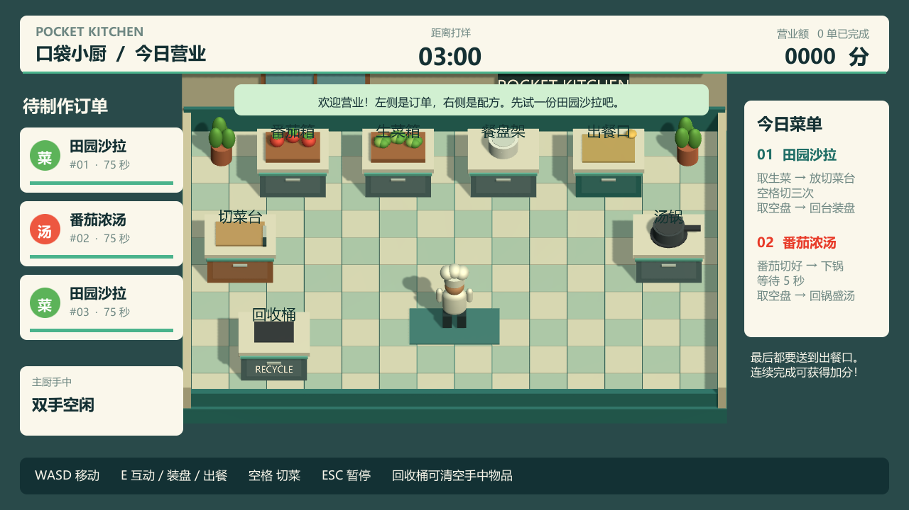
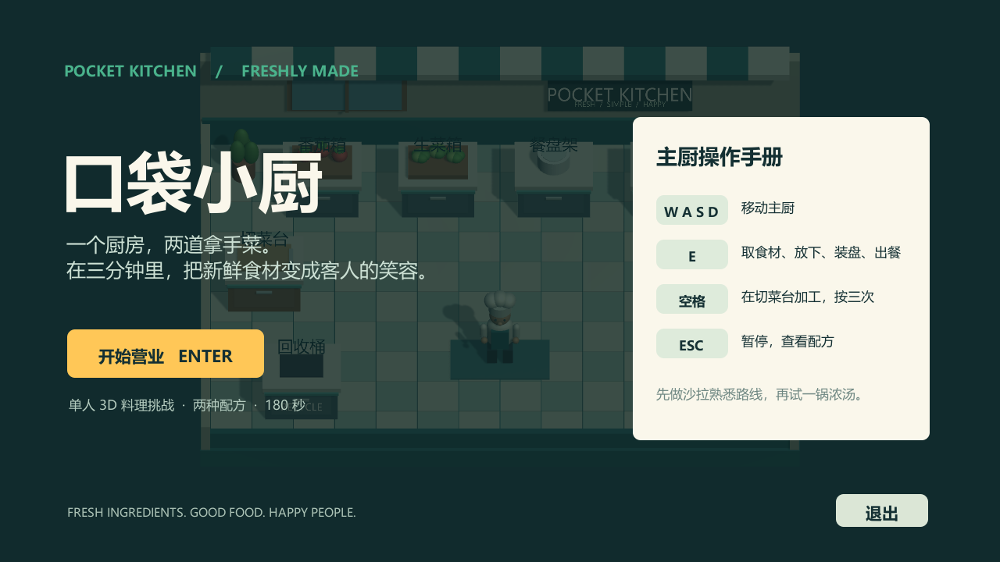

# 口袋小厨 · Pocket Kitchen

一个用 Unity 制作的单人 3D 厨房小游戏：在 180 秒内完成田园沙拉和番茄浓汤订单。

## 下载试玩

前往 [Releases](https://github.com/wcyhhh666/pocket-kitchen/releases) 下载 Windows 版本，完整解压后运行 `PocketKitchen.exe`。请保留同目录的数据文件和运行库。

| 按键 | 操作 |
|---|---|
| Enter | 开始营业；结算后重开 |
| WASD | 移动主厨 |
| E | 取食材、放下、拿起、装盘、交付 |
| 空格 | 切菜，每份食材三次 |
| Esc | 暂停 / 继续 |
| R | 结算后重开 |

拿错食材时，可到回收桶按 E 清空手中物品。

## 两道配方

**田园沙拉**：取生菜 → 切菜台放下 → 空格三次 → 去取空盘 → 回切菜台装盘 → 出餐口交付。

**番茄浓汤**：取番茄 → 切菜台切三次 → 取走并放入汤锅 → 等待五秒并取盘 → 盛汤 → 出餐口交付。

三张订单并行，每张有 75 秒耐心时间。及时完成和连续交单会获得奖励，超时会中断连单。营业结束后显示分数、完成订单数和个人最佳。

## 用 Unity 打开

1. 安装 Unity **2022.3 LTS**；本项目制作与验证版本为 **2022.3.55f1c1**。
2. 克隆或下载本仓库，在 Unity Hub 中添加仓库根目录。
3. 打开 `Assets/PocketKitchen/Scenes/PocketKitchen.unity`。
4. 点击 Play，按 Enter 开始营业。

使用内置渲染管线、传统键盘输入和系统中文字体，不依赖 MCP、云端 API 或付费素材。中文字体优先读取 Windows 系统中的 Microsoft YaHei；其他系统可能需要配置相应字体。

## 项目结构

| 目录 / 文件 | 内容 |
|---|---|
| `Assets/PocketKitchen/Scenes` | 可直接运行的厨房场景 |
| `Assets/PocketKitchen/Prefabs` | 主厨和七类台面预制体 |
| `Assets/PocketKitchen/Materials` | 场景材质 |
| `KitchenGame.cs` | 计时、订单、计分、暂停、结算和音效 |
| `ChefController.cs` | 移动、碰撞、附近交互和手持物 |
| `KitchenStation.cs` | 食材、切菜、烹饪、装盘和出餐状态 |
| `KitchenHUD.cs` | 中文菜单、订单、配方和操作提示 |
| `KitchenVisuals.cs` | 几何模型与场景生成 |
| `KitchenSmokeTest.cs` | 游戏流程和边界检查 |
| `docs/verification` | 已完成的构建与运行验证报告 |

脚本位于 `Assets/PocketKitchen/Scripts`。编辑器工具位于 `Assets/PocketKitchen/Editor`。

## 重新生成、验证与打包

Unity 菜单 `Tools > PocketKitchen` 提供三个操作：

1. **Build Kitchen Scene**：重新生成厨房场景。会替换当前打开的场景，手工修改前请先另存副本。
2. **Run Gameplay Smoke Test**：运行核心流程检查。
3. **Build Windows Game**：生成 `Builds/PocketKitchen-v1/PocketKitchen.exe`。

源码仓库不包含 Unity 缓存、机器配置和可执行文件；Windows 版本放在 Releases。

## 验证状态

2026-11-12 的 Windows 构建成功，**0 错误、0 警告**。独立运行版通过 **32 项检查**，期间记录到的运行时错误为 0，用户试玩反馈运行正常。

覆盖两道配方、无效投料、双手占用、回收、加工次数、烹饪时长、装盘、重复交单、连单、订单超时、暂停、台面碰撞、计时显示、结算和重开。报告见 [运行检查](docs/verification/gameplay-smoke-test.json) 和 [构建结果](docs/verification/build-report.json)。这些检查不代表已完成长时间游玩或平衡性测试。

## 制作参考与素材

制作顺序参考 [Code Monkey 的 Kitchen Chaos 课程](https://unitycodemonkey.com/kitchenchaoscourse.php)：场景与角色 → 台面交互 → 加工状态 → 装盘与订单 → UI 与音效 → 打包。

本项目按小型单人练习范围重新实现。几何场景、角色、食物和提示音由项目代码生成，没有打包课程原始素材、Windows 字体文件或课程成品。项目开发使用了 Codex 辅助。

